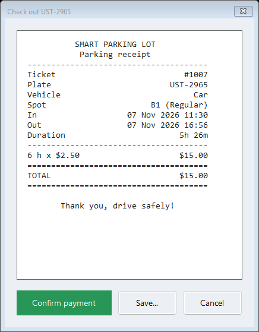
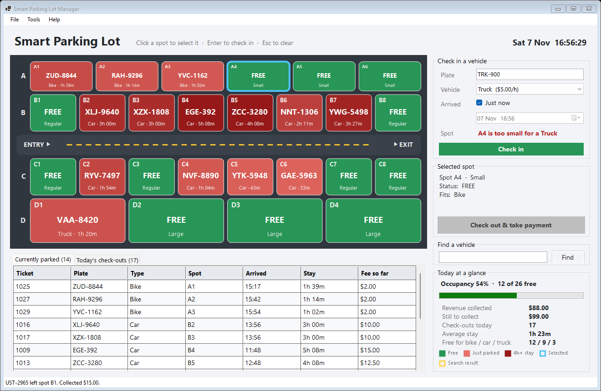
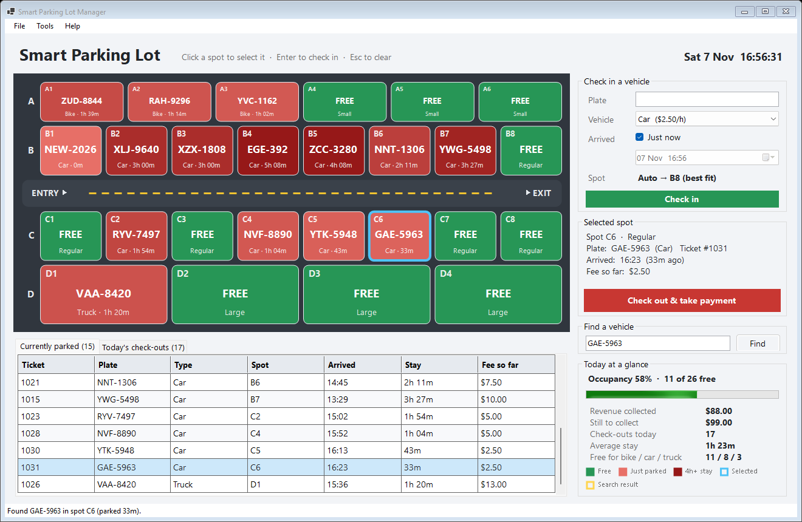

# Smart Parking Lot Manager

A C# Windows Forms (.NET 8) desktop app for running a parking lot. You get a live color-coded map, one-click check-in and check-out, automatic fees with receipts, and a daily revenue report.


## Highlights
- **Live parking map** drawn with GDI+. Green spots are free and red spots are taken. Spots get darker the longer a vehicle stays ("stay heat").
- **Best-fit auto-assign:** each vehicle gets the smallest free spot it fits in.
- **Inheritance and polymorphism:** `Bike`, `Car` and `Truck` extend an abstract `Vehicle` class with their own rates and spot sizes.
- **Automatic fees:** 15-minute grace period, then per started hour, capped at a daily maximum. Check-out shows a receipt.
- **Validation:** plate format, duplicate plates, spots that are too small, and arrival times in the future.
- **Find a vehicle** by plate, live stats, and an exported daily report.

## Screenshots
| Check-out receipt | Spot too small for a truck |
|---|---|
|  |  |

| Search result | Today's check-outs |
|---|---|
|  |  |

## Run it
```bash
dotnet run --project ParkingLotManager
```
Or open `ParkingLotManager/ParkingLotManager.csproj` in Visual Studio 2022 and press **F5**. Use **Tools > Load demo data** to fill the lot with a sample day.

The [project README](ParkingLotManager/README.md) has the full feature list, fee rules, file structure and a presentation guide. There is also a [sample daily report](sample-daily-report.txt).
